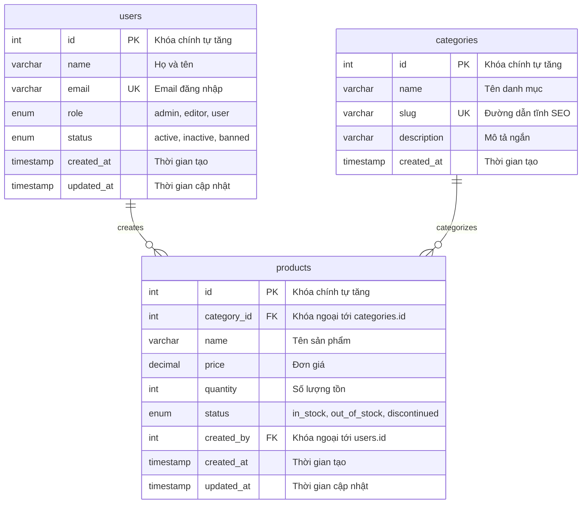

# 📖 Từ Điển Dữ Liệu MySQL (Data Dictionary) - WebQL

Tài liệu đặc tả toàn bộ cấu trúc cơ sở dữ liệu `webql_db`, chi tiết các bảng, trường dữ liệu, kiểu dữ liệu, ràng buộc và mối quan hệ.

---

## 🗺️ 1. Sơ Đồ Mối Quan Hệ Thực Thể (ERD)

---

## 📋 2. Chi Tiết Các Bảng Dữ Liệu

### 2.1. Bảng `users` (Người dùng & Phân quyền)

- **Mục đích:** Lưu trữ thông tin tài khoản thành viên, quản trị viên trong hệ thống.
- **Engine:** `InnoDB` | **Charset:** `utf8mb4_unicode_ci`

| Tên Cột (Field) | Kiểu Dữ Liệu (Type)                  | Null | Mặc Định (Default)            | Ràng Buộc / Khóa | Mô Tả Nghiệp Vụ                       |
| :-------------- | :----------------------------------- | :--: | :---------------------------- | :--------------- | :------------------------------------ |
| `id`            | `INT`                                |  ❌  | `AUTO_INCREMENT`              | `PRIMARY KEY`    | Định danh người dùng duy nhất         |
| `name`          | `VARCHAR(100)`                       |  ❌  | Không                         | Không            | Họ và tên đầy đủ                      |
| `email`         | `VARCHAR(100)`                       |  ❌  | Không                         | `UNIQUE INDEX`   | Địa chỉ email dùng để định danh       |
| `role`          | `ENUM('admin','editor','user')`      |  ❌  | `'user'`                      | `INDEX`          | Phân quyền truy cập                   |
| `status`        | `ENUM('active','inactive','banned')` |  ❌  | `'active'`                    | Không            | Trạng thái hoạt động tài khoản        |
| `created_at`    | `TIMESTAMP`                          |  ❌  | `CURRENT_TIMESTAMP`           | Không            | Ngày giờ tạo tài khoản                |
| `updated_at`    | `TIMESTAMP`                          |  ❌  | `CURRENT_TIMESTAMP ON UPDATE` | Không            | Ngày giờ cập nhật thông tin cuối cùng |

---

### 2.2. Bảng `categories` (Danh mục hệ thống)

- **Mục đích:** Phân loại nhóm các sản phẩm hoặc tài nguyên quản lý.
- **Engine:** `InnoDB` | **Charset:** `utf8mb4_unicode_ci`

| Tên Cột (Field) | Kiểu Dữ Liệu (Type) | Null | Mặc Định (Default)  | Ràng Buộc / Khóa | Mô Tả Nghiệp Vụ                      |
| :-------------- | :------------------ | :--: | :------------------ | :--------------- | :----------------------------------- |
| `id`            | `INT`               |  ❌  | `AUTO_INCREMENT`    | `PRIMARY KEY`    | Khóa chính danh mục                  |
| `name`          | `VARCHAR(100)`      |  ❌  | Không               | Không            | Tên hiển thị của danh mục            |
| `slug`          | `VARCHAR(120)`      |  ❌  | Không               | `UNIQUE INDEX`   | Slug đường dẫn tĩnh (URL friendly)   |
| `description`   | `VARCHAR(255)`      |  ✔️  | `NULL`              | Không            | Mô tả ngắn tóm tắt nội dung danh mục |
| `created_at`    | `TIMESTAMP`         |  ❌  | `CURRENT_TIMESTAMP` | Không            | Ngày giờ khởi tạo danh mục           |

---

### 2.3. Bảng `products` (Sản phẩm / Tài nguyên)

- **Mục đích:** Quản lý dữ liệu sản phẩm, giá cả, số lượng tồn kho và người tạo.
- **Engine:** `InnoDB` | **Charset:** `utf8mb4_unicode_ci`

| Tên Cột (Field) | Kiểu Dữ Liệu (Type)                              | Null | Mặc Định (Default)            | Ràng Buộc / Khóa | Mô Tả Nghiệp Vụ                                            |
| :-------------- | :----------------------------------------------- | :--: | :---------------------------- | :--------------- | :--------------------------------------------------------- |
| `id`            | `INT`                                            |  ❌  | `AUTO_INCREMENT`              | `PRIMARY KEY`    | Khóa chính sản phẩm                                        |
| `category_id`   | `INT`                                            |  ✔️  | `NULL`                        | `FOREIGN KEY`    | Khóa ngoại liên kết `categories.id` (`ON DELETE SET NULL`) |
| `name`          | `VARCHAR(200)`                                   |  ❌  | Không                         | Không            | Tên sản phẩm                                               |
| `price`         | `DECIMAL(12,2)`                                  |  ❌  | `0.00`                        | Không            | Giá bán sản phẩm                                           |
| `quantity`      | `INT`                                            |  ❌  | `0`                           | Không            | Số lượng tồn kho hiện tại                                  |
| `status`        | `ENUM('in_stock','out_of_stock','discontinued')` |  ❌  | `'in_stock'`                  | `INDEX`          | Tình trạng tồn hàng                                        |
| `created_by`    | `INT`                                            |  ✔️  | `NULL`                        | `FOREIGN KEY`    | Khóa ngoại liên kết `users.id` (`ON DELETE SET NULL`)      |
| `created_at`    | `TIMESTAMP`                                      |  ❌  | `CURRENT_TIMESTAMP`           | Không            | Thời điểm thêm sản phẩm vào hệ thống                       |
| `updated_at`    | `TIMESTAMP`                                      |  ❌  | `CURRENT_TIMESTAMP ON UPDATE` | Không            | Thời điểm sửa đổi thông tin cuối                           |
