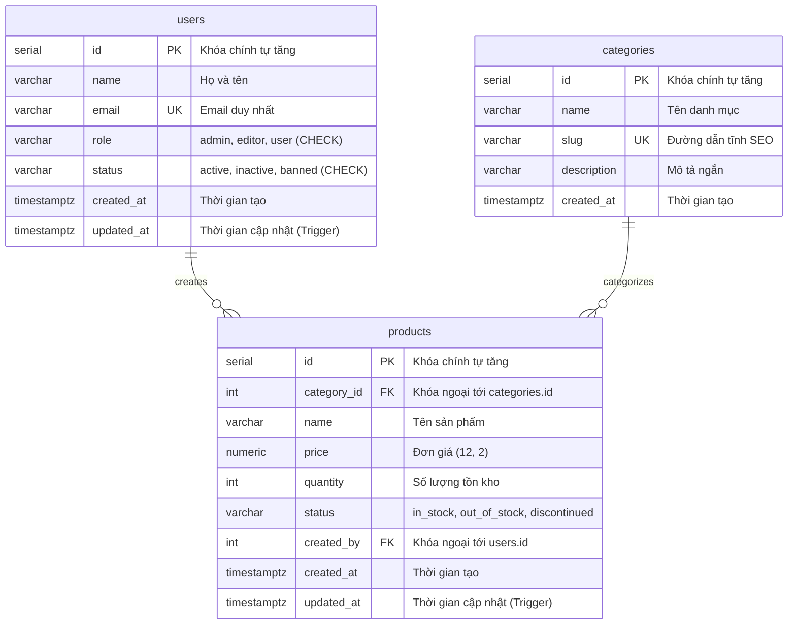

# 📖 Từ Điển Dữ Liệu PostgreSQL (Data Dictionary) - WebQL

Tài liệu đặc tả toàn bộ cấu trúc cơ sở dữ liệu `webql_db` trên **PostgreSQL**, quản lý và kết nối thông qua **DBeaver**.

---

## 🗺️ 1. Sơ Đồ Mối Quan Hệ Thực Thể (ERD)

---

## 📋 2. Chi Tiết Các Bảng Dữ Liệu (PostgreSQL Tables)

### 2.1. Bảng `users` (Quản lý tài khoản người dùng)
- **Mục đích:** Lưu trữ thông tin tài khoản thành viên và phân quyền trong hệ thống.
- **Ràng buộc:** Kiểm tra `role IN ('admin', 'editor', 'user')`, `status IN ('active', 'inactive', 'banned')`.

| Tên Cột (Column) | Kiểu Dữ Liệu (PostgreSQL) | Nullable | Mặc Định (Default) | Khóa / Ràng Buộc | Mô Tả Nghiệp Vụ |
| :--- | :--- | :---: | :--- | :--- | :--- |
| `id` | `SERIAL` (`INT4`) | ❌ | `nextval('users_id_seq')` | `PRIMARY KEY` | Khóa chính tự tăng |
| `name` | `VARCHAR(100)` | ❌ | Không | Không | Họ và tên đầy đủ |
| `email` | `VARCHAR(100)` | ❌ | Không | `UNIQUE INDEX` | Địa chỉ email dùng để định danh |
| `role` | `VARCHAR(20)` | ❌ | `'user'` | `CHECK`, `INDEX` | Phân quyền truy cập |
| `status` | `VARCHAR(20)` | ❌ | `'active'` | `CHECK` | Trạng thái hoạt động tài khoản |
| `created_at` | `TIMESTAMPTZ` | ❌ | `CURRENT_TIMESTAMP` | Không | Ngày giờ tạo tài khoản |
| `updated_at` | `TIMESTAMPTZ` | ❌ | `CURRENT_TIMESTAMP` | `Trigger` | Tự động cập nhật qua Trigger |

---

### 2.2. Bảng `categories` (Danh mục hệ thống)
- **Mục đích:** Phân loại nhóm các sản phẩm hoặc tài nguyên quản lý.

| Tên Cột (Column) | Kiểu Dữ Liệu (PostgreSQL) | Nullable | Mặc Định (Default) | Khóa / Ràng Buộc | Mô Tả Nghiệp Vụ |
| :--- | :--- | :---: | :--- | :--- | :--- |
| `id` | `SERIAL` (`INT4`) | ❌ | `nextval('categories_id_seq')` | `PRIMARY KEY` | Khóa chính danh mục |
| `name` | `VARCHAR(100)` | ❌ | Không | Không | Tên hiển thị của danh mục |
| `slug` | `VARCHAR(120)` | ❌ | Không | `UNIQUE INDEX` | Đường dẫn tĩnh SEO (URL friendly) |
| `description` | `VARCHAR(255)` | ✔️ | `NULL` | Không | Mô tả tóm tắt nội dung danh mục |
| `created_at` | `TIMESTAMPTZ` | ❌ | `CURRENT_TIMESTAMP` | Không | Thời điểm khởi tạo danh mục |

---

### 2.3. Bảng `products` (Sản phẩm / Hàng hóa)
- **Mục đích:** Quản lý danh mục hàng hóa, đơn giá, tồn kho và người tạo.

| Tên Cột (Column) | Kiểu Dữ Liệu (PostgreSQL) | Nullable | Mặc Định (Default) | Khóa / Ràng Buộc | Mô Tả Nghiệp Vụ |
| :--- | :--- | :---: | :--- | :--- | :--- |
| `id` | `SERIAL` (`INT4`) | ❌ | `nextval('products_id_seq')` | `PRIMARY KEY` | Khóa chính sản phẩm |
| `category_id` | `INT` | ✔️ | `NULL` | `FOREIGN KEY` | Khóa ngoại liên kết `categories.id` (`ON DELETE SET NULL`) |
| `name` | `VARCHAR(200)` | ❌ | Không | Không | Tên sản phẩm |
| `price` | `NUMERIC(12,2)`| ❌ | `0.00` | Không | Giá bán sản phẩm |
| `quantity` | `INT` | ❌ | `0` | Không | Số lượng tồn kho hiện tại |
| `status` | `VARCHAR(20)` | ❌ | `'in_stock'` | `CHECK`, `INDEX` | Tình trạng: in_stock, out_of_stock, discontinued |
| `created_by` | `INT` | ✔️ | `NULL` | `FOREIGN KEY` | Khóa ngoại liên kết `users.id` (`ON DELETE SET NULL`) |
| `created_at` | `TIMESTAMPTZ` | ❌ | `CURRENT_TIMESTAMP` | Không | Thời điểm thêm sản phẩm |
| `updated_at` | `TIMESTAMPTZ` | ❌ | `CURRENT_TIMESTAMP` | `Trigger` | Tự động cập nhật qua Trigger |

---

## 🦫 3. Hướng Dẫn Kết Nối Bằng DBeaver

1. **Khởi động phần mềm DBeaver**.
2. Nhấn vào biểu tượng **New Database Connection** (phím tắt `Ctrl + Shift + N` hoặc click icon ổ cứng có dấu cộng).
3. Chọn Driver: **PostgreSQL** -> Nhấn **Next**.
4. Điền các thông số kết nối:
   * **Host:** `localhost`
   * **Port:** `5432`
   * **Database:** `webql_db`
   * **Authentication:** `Database Native`
   * **Username:** `postgres`
   * **Password:** `123456` *(hoặc mật khẩu bạn đã cài khi cài đặt PostgreSQL)*
5. Bấm nút **Test Connection...** để kiểm tra (DBeaver sẽ tự động tải Driver PostgreSQL nếu là lần đầu tiên).
6. Bấm **Finish** để lưu kết nối.
7. Khi mở `webql_db` trong DBeaver:
   * Vào `Databases` -> `webql_db` -> `Schemas` -> `public` -> `Tables` để xem các bảng và dữ liệu.
   * Để xem sơ đồ ERD trực quan: Click đúp vào schema `public` -> Chọn tab **ER Diagram**.
