# 📖 Từ Điển Dữ Liệu PostgreSQL (Data Dictionary) - PetHub (16 Bảng)

Tài liệu đặc tả toàn bộ **16 bảng** trong cơ sở dữ liệu `postgres` trên **PostgreSQL**, quản lý và kết nối thông qua **DBeaver** cho dự án PetHub.

---

## 🗺️ 1. Sơ Đồ Mối Quan Hệ Thực Thể (ERD)

```mermaid
erDiagram
    roles ||--o{ users : "defines"
    users ||--o{ carts : "owns"
    users ||--o{ orders : "places"
    users ||--o{ appointments : "books"
    users ||--o{ inventory_logs : "records"
    users ||--o{ audit_logs : "triggers"
    categories ||--o{ products : "categorizes"
    products ||--o{ product_images : "has"
    products ||--o{ cart_items : "contained_in"
    products ||--o{ order_items : "ordered_in"
    products ||--o{ inventory_logs : "logged_in"
    services ||--o{ appointments : "offers"
    carts ||--o{ cart_items : "holds"
    orders ||--o{ order_items : "includes"
    orders ||--o{ transactions : "generates"
    appointments ||--o{ transactions : "generates"

    roles {
        serial role_id PK "1-Admin, 2-Manager, 3-Staff, 4-Customer"
        varchar role_name UK "Tên quyền"
    }

    users {
        serial user_id PK "Khóa chính"
        int role_id FK "Liên kết roles.role_id"
        varchar full_name "Họ và tên"
        varchar email UK "Email đăng nhập"
        varchar password_hash "Mật khẩu mã hóa (bcrypt)"
        varchar phone "Số điện thoại"
        text address "Địa chỉ giao hàng"
        text avatar_url "Link ảnh đại diện"
        varchar reset_password_token "Mã đặt lại mật khẩu"
        timestamp reset_password_expires "Hạn token"
        timestamp created_at "Thời gian tạo"
        boolean is_active "Trạng thái hoạt động"
    }

    categories {
        serial category_id PK "Khóa chính"
        varchar category_name "Tên danh mục"
        text description "Mô tả danh mục"
        boolean is_active "Trạng thái hiển thị"
    }

    products {
        serial product_id PK "Khóa chính"
        int category_id FK "Liên kết categories.category_id"
        varchar sku UK "Mã sản phẩm duy nhất"
        varchar product_name "Tên sản phẩm"
        text description "Mô tả chi tiết"
        decimal price "Đơn giá (10, 2)"
        int stock_quantity "Số lượng tồn kho"
        timestamp created_at "Ngày tạo"
        boolean is_active "Trạng thái bán hàng"
    }

    product_images {
        serial image_id PK "Khóa chính"
        int product_id FK "Liên kết products.product_id (CASCADE)"
        text image_url "Đường dẫn ảnh"
        boolean is_primary "Ảnh bìa chính"
    }

    inventory_logs {
        serial log_id PK "Khóa chính"
        int product_id FK "Liên kết products.product_id"
        int user_id FK "Nhân viên thực hiện (users.user_id)"
        int change_quantity "Số lượng biến động (+/-)"
        varchar reason "Lý do nhập/xuất kho"
        timestamp created_at "Thời điểm ghi nhận"
    }

    orders {
        serial order_id PK "Khóa chính"
        int customer_id FK "Khách đăng nhập (NULL: vãng lai)"
        varchar buyer_name "Tên người nhận"
        varchar buyer_phone "Số điện thoại người nhận"
        varchar buyer_email "Email gửi xác nhận"
        text shipping_address "Địa chỉ nhận hàng"
        decimal total_amount "Tổng tiền hàng gốc"
        decimal discount_amount "Tiền giảm giá"
        decimal final_amount "Tiền khách thực trả"
        timestamp order_date "Thời điểm đặt hàng"
        varchar status "Pending, Confirmed, Shipping, Completed, Cancelled"
        text admin_notes "Ghi chú nội bộ"
    }

    order_items {
        serial order_item_id PK "Khóa chính"
        int order_id FK "Liên kết orders.order_id (CASCADE)"
        int product_id FK "Liên kết products.product_id"
        int quantity "Số lượng mua (> 0)"
        decimal unit_price "Đơn giá chốt tại thời điểm mua"
    }

    services {
        serial service_id PK "Khóa chính"
        varchar service_name "Tên dịch vụ Spa"
        decimal price "Đơn giá dịch vụ"
    }

    appointments {
        serial appointment_id PK "Khóa chính"
        int customer_id FK "Khách đặt lịch"
        varchar guest_name "Tên khách hẹn"
        varchar guest_phone "Số điện thoại khách"
        int staff_id FK "Nhân viên phụ trách"
        int service_id FK "Dịch vụ Spa được chọn"
        timestamp appointment_date "Thời gian hẹn"
        decimal total_amount "Tổng tiền dịch vụ"
        varchar payment_status "Unpaid, Paid, Refunded"
        varchar status "Scheduled, Completed, Cancelled"
    }

    transactions {
        serial transaction_id PK "Khóa chính"
        int order_id FK "Liên kết orders.order_id"
        int appointment_id FK "Liên kết appointments.appointment_id"
        varchar payment_method "COD, VNPay, MoMo..."
        decimal amount "Số tiền thanh toán"
        timestamp transaction_date "Thời gian giao dịch"
        varchar status "Success, Pending, Failed"
    }

    carts {
        serial cart_id PK "Khóa chính"
        int user_id UK "Chủ sở hữu giỏ hàng (CASCADE)"
    }

    cart_items {
        serial cart_item_id PK "Khóa chính"
        int cart_id FK "Liên kết carts.cart_id (CASCADE)"
        int product_id FK "Liên kết products.product_id (CASCADE)"
        int quantity "Số lượng chọn (> 0)"
    }

    banners {
        serial banner_id PK "Khóa chính"
        text image_url "Đường dẫn ảnh banner"
        text target_link "Đường link khi click"
        int sort_order "Thứ tự sắp xếp"
        boolean is_active "Bật/Tắt hiển thị"
    }

    site_settings {
        varchar setting_key PK "Tên cấu hình"
        text setting_value "Giá trị cấu hình"
    }

    audit_logs {
        serial log_id PK "Khóa chính"
        int user_id FK "Người thực hiện hành động"
        varchar action "Tên hành động"
        varchar entity_name "Tên đối tượng bị tác động"
        text details "Chi tiết nhật ký"
        timestamp created_at "Thời điểm thực hiện"
    }
```

---

## 📋 2. Chi Tiết Các Bảng Dữ Liệu (16 Bảng)

### 2.1. `roles` (Phân Quyền Hệ Thống - 4 Cấp Bậc)
- `1 - Admin`: Toàn quyền hệ thống.
- `2 - Manager`: Quản lý kho hàng, doanh thu và xem thống kê.
- `3 - Staff`: Nhân viên bán hàng, cập nhật trạng thái đơn và lịch hẹn Spa.
- `4 - Customer`: Khách hàng mua sắm và đặt lịch hẹn.

### 2.2. `users` (Tài Khoản & Hội Viên)
Chứa thông tin đăng nhập, hồ sơ, mật khẩu băm Bcrypt, token đặt lại mật khẩu và trạng thái kích hoạt.

### 2.3. `categories` & 2.4. `products` & 2.5. `product_images`
Quản lý cây danh mục sản phẩm, chi tiết sản phẩm tồn kho và bộ sưu tập ảnh (có cờ `is_primary`).

### 2.6. `inventory_logs` (Nhật Ký Kho Hàng - Bảng Mới)
Ghi nhận mọi biến động tồn kho:
- `change_quantity > 0`: Nhập hàng vào kho.
- `change_quantity < 0`: Xuất hàng (bán cho đơn hàng hoặc hủy hàng lỗi).

### 2.7. `orders` & 2.8. `order_items`
- Quản lý đơn hàng thương mại điện tử.
- `total_amount`: Tổng tiền hàng gốc.
- `discount_amount`: Tiền giảm giá.
- `final_amount`: Tiền thực thu từ khách hàng.

### 2.9. `services` & 2.10. `appointments` (Dịch Vụ Spa & Đặt Lịch Hẹn - Bảng Mới)
Quản lý các gói Spa (tắm sấy, tỉa lông, nhuộm lông) và lịch hẹn làm đẹp của khách hàng cùng thú cưng.

### 2.11. `transactions` (Giao Dịch Dòng Tiền)
Gom chung giao dịch thanh toán từ cả **Đơn hàng (`order_id`)** và **Lịch hẹn Spa (`appointment_id`)** theo ràng buộc `chk_transaction_source`.

### 2.12. `carts` & 2.13. `cart_items` (Giỏ Hàng Trực Tuyến)
Đồng bộ giỏ hàng cá nhân hóa cho từng hội viên.

### 2.14. `banners`, 2.15. `site_settings` & 2.16. `audit_logs` (Cấu Hình & Nhật Ký - Bảng Mới)
- `banners`: Banner quảng cáo trang chủ.
- `site_settings`: Cấu hình website (tên cửa hàng, hotline, địa chỉ).
- `audit_logs`: Nhật ký kiểm toán thao tác quản trị.

---

## 🦫 3. Kết Nối & Quản Lý Bằng DBeaver

1. **Khởi động DBeaver** -> Nhấn **New Database Connection** -> Chọn **PostgreSQL**.
2. Nhập thông số:
   - **Host:** `localhost` | **Port:** `5432`
   - **Database:** `postgres`
   - **Username:** `postgres` | **Password:** `123456`
3. Nhấn **Test Connection ...** -> Bấm **Finish**.
4. Mở: `Databases` ➔ `postgres` ➔ `Schemas` ➔ `public` ➔ `Tables` để xem đầy đủ **16 bảng**.
5. Click đúp vào `public` ➔ chọn tab **ER Diagram** để xem toàn bộ sơ đồ liên kết khóa ngoại.
